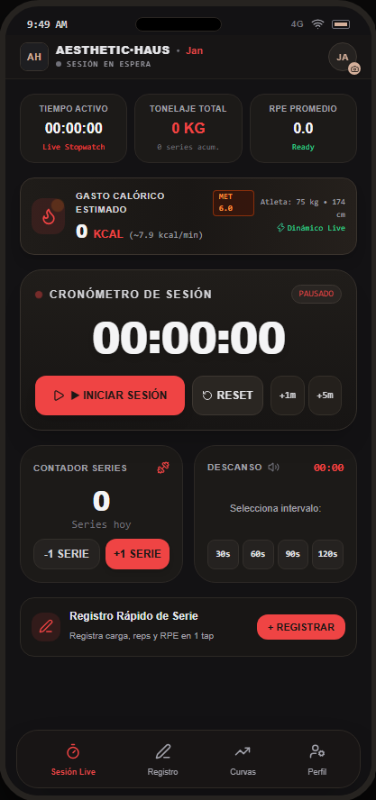
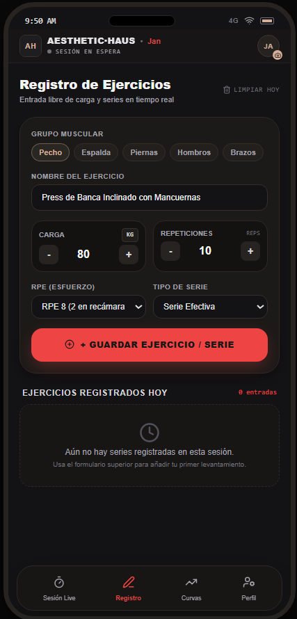
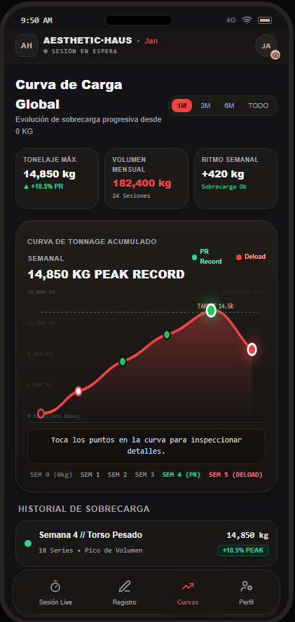
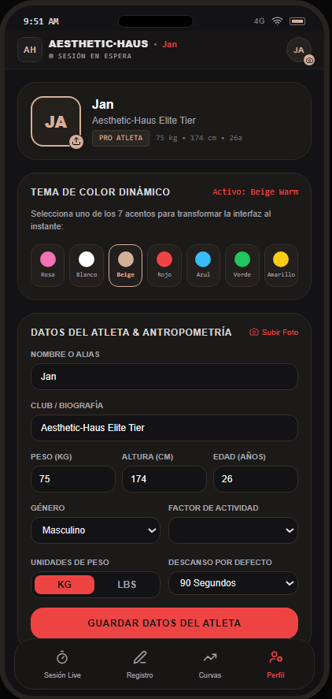
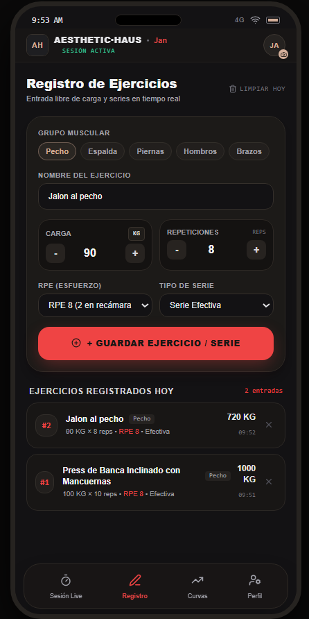
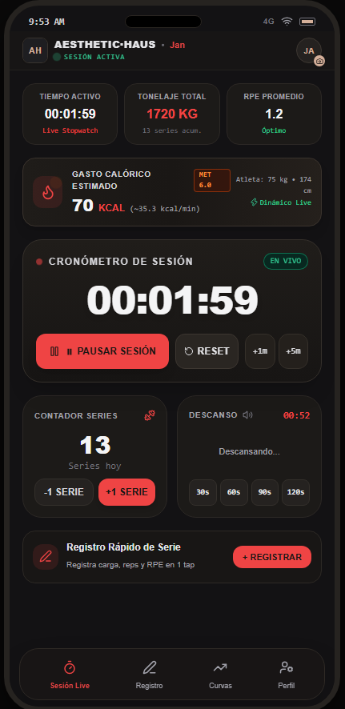

# 🏋️ Aesthetic-Haus

Aesthetic-Haus es una aplicación web para la planificación, personalización y seguimiento de entrenamientos.

El proyecto ha sido desarrollado durante mi formación en 2.º de Desarrollo de Aplicaciones Multiplataforma (DAM), aplicando conocimientos de desarrollo web, almacenamiento local, aplicaciones PWA y publicación mediante GitHub Pages.

## 🌐 Aplicación publicada

Puedes acceder a la aplicación desde GitHub Pages:

**https://jannvar.github.io/aesthetic-haus/**

## ✨ Funcionalidades

- Creación y personalización del perfil del usuario.
- Gestión y seguimiento de entrenamientos.
- Conservación de la sesión al cerrar la aplicación.
- Almacenamiento local de la información.
- Diseño adaptable a distintos tamaños de pantalla.
- Funcionamiento como aplicación web instalable.
- Detección automática de nuevas versiones.
- Aviso cuando existe una actualización disponible.
- Actualización de la aplicación sin eliminar los datos guardados.
- Funcionamiento sin conexión para los recursos almacenados en caché.

## 🛠️ Tecnologías utilizadas

- HTML5
- CSS3
- JavaScript
- LocalStorage
- Service Worker
- Web App Manifest
- Progressive Web App (PWA)
- Git
- GitHub
- GitHub Pages

## 📲 Instalación de la aplicación

Aesthetic-Haus puede utilizarse directamente desde el navegador o instalarse como una aplicación PWA.

### En ordenador

1. Abre la aplicación desde Google Chrome o Microsoft Edge.
2. Pulsa el icono de instalación que aparece en la barra de direcciones.
3. Confirma la instalación.
4. La aplicación aparecerá como un programa independiente.

### En Android

1. Abre la aplicación desde Google Chrome.
2. Pulsa el menú de los tres puntos.
3. Selecciona **Instalar aplicación** o **Añadir a pantalla de inicio**.
4. Confirma la instalación.

### En iPhone o iPad

1. Abre la aplicación desde Safari.
2. Pulsa el botón **Compartir**.
3. Selecciona **Añadir a pantalla de inicio**.
4. Confirma la instalación.

## 💾 Almacenamiento de datos

La aplicación utiliza el almacenamiento local del navegador para conservar la información del usuario.

Los datos permanecen guardados cuando:

- Se cierra y se vuelve a abrir la aplicación.
- Se recarga la página.
- Se instala una versión nueva.
- Se actualiza la aplicación desde el aviso correspondiente.
- Se modifican los archivos publicados en GitHub Pages.

Los datos podrían perderse si el usuario elimina manualmente los datos del sitio, borra el almacenamiento del navegador o desinstala la aplicación eliminando también sus datos.

## 🔄 Sistema de actualización

Aesthetic-Haus comprueba si existe una versión más reciente mediante el archivo `version.json`.

El proceso de actualización es el siguiente:

1. Se modifica el código del proyecto.
2. Se incrementa el número de versión.
3. Los cambios se suben a GitHub.
4. GitHub Pages publica la nueva versión.
5. Aesthetic-Haus detecta la actualización.
6. La aplicación muestra un aviso al usuario.
7. El usuario pulsa el botón de actualización.
8. Se cargan los nuevos archivos de la aplicación.
9. La sesión, la personalización y los entrenamientos permanecen guardados.

## 🚀 Ejecución local

Para ejecutar el proyecto en un ordenador:

1. Clona el repositorio:

```bash
git clone https://github.com/JannVar/aesthetic-haus.git
```

2. Entra en la carpeta del proyecto:

```bash
cd aesthetic-haus
```

3. Abre la carpeta con Visual Studio Code.

4. Ejecuta el proyecto mediante un servidor local. Por ejemplo, puedes utilizar la extensión **Live Server** de Visual Studio Code.

> No se recomienda abrir `index.html` directamente mediante `file://`, porque el Service Worker y otras funciones de la aplicación necesitan ejecutarse desde HTTP o HTTPS.

## 📁 Estructura del proyecto

```text
aesthetic-haus/
├── icons/
├── index.html
├── manifest.webmanifest
├── sw.js
├── version.json
├── README.md
└── LICENSE
```

### Archivos principales

- `index.html`: contiene la estructura, los estilos y la lógica principal de la aplicación.
- `manifest.webmanifest`: configura la aplicación como PWA.
- `sw.js`: gestiona la caché y la actualización de los recursos.
- `version.json`: indica la versión publicada y permite detectar actualizaciones.
- `icons/`: contiene los iconos utilizados por la aplicación.
- `LICENSE`: incluye la licencia del proyecto.

## 📌 Versión actual

La versión estable actual es la **1.2.1**.

En esta versión se corrigió el sistema de actualización para conservar correctamente la sesión, la personalización y los entrenamientos almacenados.

## 📸 Capturas de pantalla

### Pantalla principal



### Gestión de entrenamientos



### Curva de entrenamiento



### Personalización



### Otras funciones




## 🚧 Estado del proyecto

El proyecto se encuentra en desarrollo activo.

Las funciones principales están operativas y el sistema de actualización conserva correctamente la información almacenada localmente.

## 🔒 Privacidad

La información del usuario se almacena localmente en su dispositivo. La aplicación no necesita enviar los entrenamientos ni la personalización a un servidor externo para conservarlos.

## 👤 Autor

**Alejandro Mosquete Mendoza**

Estudiante de 2.º de Desarrollo de Aplicaciones Multiplataforma.

- GitHub: https://github.com/JannVar

## 📄 Licencia

Este proyecto se distribuye bajo la licencia MIT. Consulta el archivo LICENSE para obtener más información.
